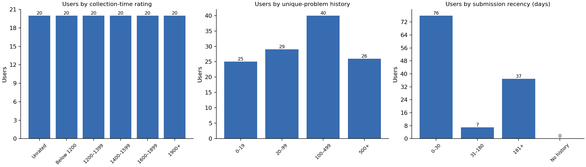
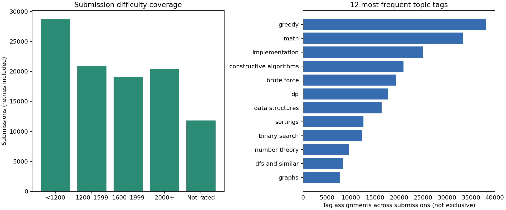

# Full cohort data and split audit

Generated from captured data and frozen feature artifacts. No models have been trained; these are
coverage checks, not model results or proof of generalization.

## Collection

Selection frozen: `2026-10-23T10:19:03.840246+00:00`. Random seed: 42. Raw data and handle mappings
remain excluded from Git.

| Measure                        | Observed |
| ------------------------------ | -------: |
| Completed users                |      120 |
| Submissions                    |  100,919 |
| Eligible first-attempt rows    |   41,828 |
| Submissions without difficulty |   11,820 |
| Submissions without tags       |   11,265 |
| Team submissions               |    6,598 |
| Failed/review captures         |        0 |

Recorded rating-eligibility replacements: **8**. Directory/profile mismatches used seeded
same-source reserves confirmed by current profile; original membership, mismatch evidence, and
available captures are preserved under local `changes/`. No submission outcomes or model scores were
used to choose replacements.

| Rating group | Target users | Completed users |
| ------------ | -----------: | --------------: |
| unrated      |           20 |              20 |
| below_1200   |           20 |              20 |
| 1200_1399    |           20 |              20 |
| 1400_1599    |           20 |              20 |
| 1600_1899    |           20 |              20 |
| 1900_plus    |           20 |              20 |





## Recruitment sources

| Rating group | Source                    | Completed users |
| ------------ | ------------------------- | --------------: |
| 1200_1399    | active_rated              |              10 |
| 1200_1399    | broad_rated               |              10 |
| 1400_1599    | active_rated              |              10 |
| 1400_1599    | broad_rated               |              10 |
| 1600_1899    | active_rated              |              10 |
| 1600_1899    | broad_rated               |              10 |
| 1900_plus    | active_rated              |              10 |
| 1900_plus    | broad_rated               |              10 |
| below_1200   | active_rated              |              10 |
| below_1200   | broad_rated               |              10 |
| unrated      | recent_public_submissions |              20 |

## Participation across submissions

| Category           |  Count |
| ------------------ | -----: |
| CONTESTANT         | 28,849 |
| OUT_OF_COMPETITION |  3,813 |
| PRACTICE           | 54,449 |
| VIRTUAL            | 13,808 |

## Verdicts across submissions

| Category                |  Count |
| ----------------------- | -----: |
| CHALLENGED              |    163 |
| COMPILATION_ERROR       |  2,220 |
| IDLENESS_LIMIT_EXCEEDED |    219 |
| MEMORY_LIMIT_EXCEEDED   |  1,305 |
| OK                      | 46,604 |
| PARTIAL                 |    377 |
| PRESENTATION_ERROR      |      4 |
| RUNTIME_ERROR           |  3,259 |
| SKIPPED                 |    500 |
| TIME_LIMIT_EXCEEDED     |  7,606 |
| WRONG_ANSWER            | 38,662 |

## First-attempt exclusions

| Category                    | Count |
| --------------------------- | ----: |
| excluded_or_pending_verdict | 1,047 |
| missing_problem_identity    |    24 |
| non_individual              | 2,540 |
| special_or_non_programming  |   526 |

## Frozen split coverage

| Split            |   Rows | Users | Accepted | Rejected | Cold-start rows |
| ---------------- | -----: | ----: | -------: | -------: | --------------: |
| train            | 22,752 |    61 |   13,613 |    9,139 |             149 |
| validation       |  4,875 |    46 |    3,118 |    1,757 |              25 |
| temporal_test    |  4,876 |    65 |    3,266 |    1,610 |             103 |
| unseen_user_test |  1,182 |    17 |      797 |      385 |               3 |

Unseen-user context: 8,143 rows, excluded from fitting, tuning, and scoring. Only earlier personal
history informs later held-out predictions.

| Boundary         | UTC timestamp             |
| ---------------- | ------------------------- |
| validation_start | 2025-10-06T14:36:41+00:00 |
| test_start       | 2026-05-27T10:23:15+00:00 |

| Split            | Users represented per rating group                                                    |
| ---------------- | ------------------------------------------------------------------------------------- |
| train            | unrated: 0; below_1200: 7; 1200_1399: 11; 1400_1599: 12; 1600_1899: 15; 1900_plus: 16 |
| validation       | unrated: 1; below_1200: 8; 1200_1399: 12; 1400_1599: 8; 1600_1899: 6; 1900_plus: 11   |
| temporal_test    | unrated: 16; below_1200: 11; 1200_1399: 11; 1400_1599: 9; 1600_1899: 9; 1900_plus: 9  |
| unseen_user_test | unrated: 3; below_1200: 3; 1200_1399: 4; 1400_1599: 2; 1600_1899: 3; 1900_plus: 2     |

## Training feature missingness

Measured on training rows only. No imputation, scaling, or tag vocabulary has been fitted.

| Numeric input               | Missing training rows |
| --------------------------- | --------------------: |
| prior_problems_attempted    |                     0 |
| prior_problems_solved       |                     0 |
| prior_first_attempts_judged |                     0 |
| prior_first_acceptance_rate |                   149 |
| recent_20_acceptance_rate   |                   149 |
| recent_20_count             |                     0 |
| topic_prior_attempts_mean   |                   912 |
| topic_prior_judged_mean     |                   912 |
| topic_acceptance_rate_mean  |                 1,178 |
| historical_rating           |                   700 |
| historical_rating_missing   |                     0 |
| problem_rating              |                   881 |
| problem_rating_missing      |                     0 |
| rating_gap                  |                 1,555 |
| days_since_previous_attempt |                    37 |
| attempts_previous_30_days   |                     0 |
| tag_count                   |                     0 |

## Pre-model gates

Thresholds were declared in `sampling.md` before full collection. Passing them permits development
to proceed; it does not establish statistical power or reliable subgroup predictions.

| Gate                               | Result |
| ---------------------------------- | ------ |
| complete_120_user_quota            | PASS   |
| train_coverage                     | PASS   |
| validation_coverage                | PASS   |
| temporal_test_coverage             | PASS   |
| unseen_user_test_coverage          | PASS   |
| unseen_rating_coverage             | PASS   |
| user_disjointness                  | PASS   |
| unique_user_problem_rows           | PASS   |
| time_ordering                      | PASS   |
| source_integrity                   | PASS   |
| candidate_snapshot_integrity       | PASS   |
| unique_handles_and_smoke_exclusion | PASS   |
| feature_input_allowlist            | PASS   |
| balanced_training_user_weights     | PASS   |

## User dominance and limitations

- Largest user's eligible-row share: **7.6%**.
- Top 10% of users' eligible-row share: **48.9%**.
- Training weights use training counts only and equalize total weight across represented training
  users. Report both submission-level and user-averaged metrics after fitting.
- Quota sampling is not population-representative.
- Rated strata mix 10 active-directory and 10 broad-directory users; active-directory membership is
  not the same as recent submission activity.
- Broad and unrated candidate snapshots are reused from the documented pilot on the same collection
  date.
- Unrated candidates are recent public submitters; inactive and zero-history unrated users are not
  covered.
- History size and submission recency are audited after selection; no performance-based resampling
  is allowed.
- No users who are currently unrated have training-period rows under these chronological cutoffs.
  Historical unrated states of later-rated users can occur, but performance for never-rated users
  must be evaluated separately; aggregate coverage does not resolve that domain shift.
- No reweighting establishes whole-platform representativeness. Within-group uncertainty, sparse
  groups, and errors must still be reported.
- Historical verdict-availability timestamps are unavailable. Features use a one-day outcome lag;
  delayed judging and rejudging remain limitations. Problem tags/difficulty use current snapshots.
- Static website, models, validation-only selection, final test evaluation, and student defense
  remain unfinished.

## Reproduction

```bash
python3 code/select_users.py
python3 code/collect_data.py --output data/raw --per-group 20 --batch-profiles
# If profile checks flag stale rating strata, stop collection, verify, and resume:
python3 code/check_users.py
python3 code/make_features.py --source data/raw --output data/processed
python3 code/check_data.py
python3 -m unittest discover -s tests -v
```

Existing selection and completed captures are reused. Fresh live snapshots can differ; source
SHA-256 hashes and capture timestamps identify this dataset. Generated aggregate plots need
matplotlib; capture and feature scripts use only the Python standard library.
