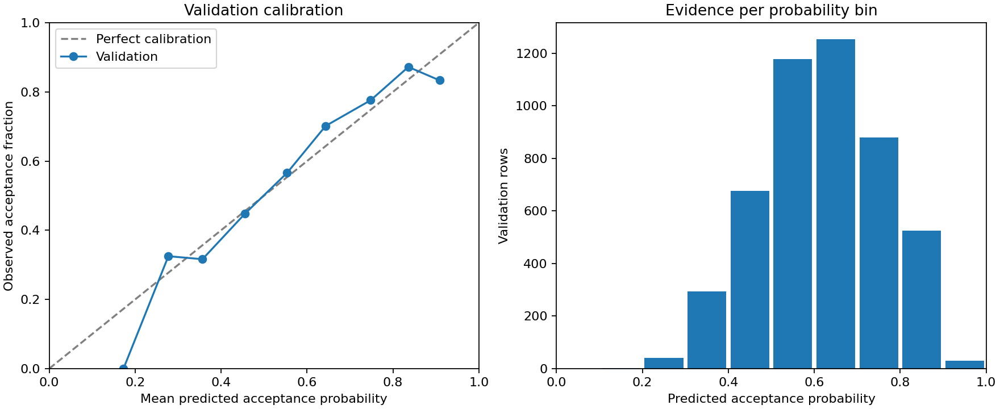

# Validation model checks

> This report records the development stage before final testing. The subsequent
> [final test report](test_results.md) contains the completed reserved-test evaluation.

Model: **Random Forest depth=16**. Final tests remain unscored.

## Sensitivity checks

The selected model settings are held fixed. Each variant refits preprocessing and the model using
training rows only, then scores the identical validation rows. These are stress tests, not new
hyperparameter searches. The original one-day policy remains the primary specification; a longer lag
cannot reconstruct unavailable historical verdict times. Removing difficulty also removes its
missing indicator and rating gap, but does not remove snapshot topic bias.

| Variant               | User log loss | Submission log loss | User Brier |
| --------------------- | ------------: | ------------------: | ---------: |
| Original: one-day lag |        0.6074 |              0.5993 |     0.2102 |
| Without difficulty    |        0.6316 |              0.6167 |     0.2208 |
| Seven-day outcome lag |        0.6107 |              0.6012 |     0.2117 |

## Uncertainty

Paired bootstrap with 2,000 resamples of 46 validation users, seed 42. Each sampled user contributes
their full history and equal weight. The 95% percentile interval for user-averaged log loss is
0.5845–0.6290. Model minus baseline log loss is -0.0624, with interval [-0.0834, -0.0424]; negative
favors the model.

These intervals condition on the fitted model and this sampled cohort. They do not account for
model-selection optimism, recruitment bias, or dependence between users attempting shared problems.
They are not final-test confidence intervals.

## Calibration



Fixed bins of width 0.1 show submission-weighted observed versus predicted acceptance. Empty bins
are omitted; the second panel shows evidence counts. Brier and log loss complement this diagnostic.
No calibration mapping is fitted on these validation labels.

## Subgroups

User log loss is averaged within each subgroup. Collection-time rating is descriptive metadata,
never a model input; it is not the rating at prediction time. Topics overlap, so their counts cannot
be added. Sparse means fewer than 10 users or 100 rows, a descriptive warning rather than a
statistical guarantee.

| Group                  | Value                     | Rows | Users | User log loss | Baseline | Sparse |
| ---------------------- | ------------------------- | ---: | ----: | ------------: | -------: | ------ |
| Collection-time rating | 1200–1399                 |  972 |    12 |        0.6215 |   0.6817 | No     |
| Collection-time rating | 1400–1599                 |  890 |     8 |        0.6097 |   0.6638 | Yes    |
| Collection-time rating | 1600–1899                 |  801 |     6 |        0.5980 |   0.6685 | Yes    |
| Collection-time rating | 1900+                     | 1593 |    11 |        0.5571 |   0.6503 | No     |
| Collection-time rating | Below 1200                |  609 |     8 |        0.6496 |   0.6786 | Yes    |
| Collection-time rating | Unrated                   |   10 |     1 |        0.6895 |   0.7244 | Yes    |
| Difficulty             | 1200–1599                 | 1219 |    43 |        0.6212 |   0.6962 | No     |
| Difficulty             | 1600+                     |  987 |    34 |        0.6289 |   0.7255 | No     |
| Difficulty             | Below 1200                | 2387 |    46 |        0.5319 |   0.6389 | No     |
| Difficulty             | Not rated                 |  282 |    16 |        0.6788 |   0.6779 | No     |
| Historical rating      | No prior rating           |  197 |    19 |        0.7237 |   0.6990 | No     |
| Historical rating      | Prior rating available    | 4678 |    43 |        0.5914 |   0.6676 | No     |
| Outcome history        | Judged history available  | 4850 |    46 |        0.6039 |   0.6679 | No     |
| Outcome history        | No judged history         |   25 |    15 |        0.8751 |   0.7017 | Yes    |
| Prior attempts         | 0–19                      |  301 |    18 |        0.6675 |   0.6876 | No     |
| Prior attempts         | 100–499                   | 1617 |    19 |        0.5989 |   0.6706 | No     |
| Prior attempts         | 20–99                     |  904 |    20 |        0.6522 |   0.6930 | No     |
| Prior attempts         | 500+                      | 2053 |    15 |        0.5608 |   0.6547 | No     |
| Topic                  | 2-sat                     |    5 |     3 |        0.7866 |   0.6069 | Yes    |
| Topic                  | No tags                   |  282 |    18 |        0.6859 |   0.6865 | No     |
| Topic                  | binary search             |  465 |    43 |        0.6403 |   0.6979 | No     |
| Topic                  | bitmasks                  |  345 |    42 |        0.5760 |   0.6874 | No     |
| Topic                  | brute force               |  817 |    46 |        0.5919 |   0.6582 | No     |
| Topic                  | chinese remainder theorem |   14 |    11 |        0.6111 |   0.6567 | Yes    |
| Topic                  | combinatorics             |  207 |    33 |        0.6529 |   0.7020 | No     |
| Topic                  | communication             |   14 |     7 |        0.6155 |   0.7621 | Yes    |
| Topic                  | constructive algorithms   | 1015 |    44 |        0.6335 |   0.6886 | No     |
| Topic                  | data structures           |  495 |    44 |        0.6308 |   0.6988 | No     |
| Topic                  | dfs and similar           |  255 |    35 |        0.6776 |   0.7118 | No     |
| Topic                  | divide and conquer        |   78 |    22 |        0.6475 |   0.7088 | Yes    |
| Topic                  | dp                        |  790 |    43 |        0.6357 |   0.6808 | No     |
| Topic                  | dsu                       |  122 |    28 |        0.6468 |   0.7133 | No     |
| Topic                  | expression parsing        |   15 |    14 |        0.9690 |   0.7432 | Yes    |
| Topic                  | fft                       |   20 |    13 |        0.6419 |   0.7157 | Yes    |
| Topic                  | flows                     |    9 |     7 |        0.7241 |   0.7690 | Yes    |
| Topic                  | games                     |  188 |    41 |        0.5745 |   0.6647 | No     |
| Topic                  | geometry                  |   65 |    24 |        0.7045 |   0.7076 | Yes    |
| Topic                  | graph matchings           |   23 |    15 |        0.7294 |   0.7671 | Yes    |
| Topic                  | graphs                    |  236 |    33 |        0.6549 |   0.7416 | No     |
| Topic                  | greedy                    | 2291 |    46 |        0.5910 |   0.6681 | No     |
| Topic                  | hashing                   |   23 |    13 |        0.6364 |   0.6195 | Yes    |
| Topic                  | implementation            | 1269 |    45 |        0.5890 |   0.6678 | No     |
| Topic                  | interactive               |  121 |    27 |        0.6759 |   0.7140 | No     |
| Topic                  | math                      | 1869 |    46 |        0.5998 |   0.6664 | No     |
| Topic                  | matrices                  |   27 |    14 |        0.6666 |   0.7270 | Yes    |
| Topic                  | meet-in-the-middle        |    3 |     3 |        0.4659 |   0.7404 | Yes    |
| Topic                  | number theory             |  498 |    43 |        0.6269 |   0.6932 | No     |
| Topic                  | probabilities             |   30 |    13 |        0.6769 |   0.7112 | Yes    |
| Topic                  | schedules                 |   33 |    18 |        0.8064 |   0.7137 | Yes    |
| Topic                  | shortest paths            |   39 |    23 |        0.7281 |   0.7308 | Yes    |
| Topic                  | sortings                  |  610 |    45 |        0.6341 |   0.6706 | No     |
| Topic                  | string suffix structures  |   10 |     6 |        0.5748 |   0.7204 | Yes    |
| Topic                  | strings                   |  361 |    42 |        0.6027 |   0.6449 | No     |
| Topic                  | ternary search            |   17 |    10 |        0.6062 |   0.6867 | Yes    |
| Topic                  | trees                     |  211 |    30 |        0.6181 |   0.6996 | No     |
| Topic                  | two pointers              |  323 |    45 |        0.6193 |   0.6867 | No     |

## Findings to carry into the website

- **Not rated**: model user log loss 0.6788 exceeds baseline 0.6779 (282 rows, 16 users). Treat
  advice for this group cautiously; sparse evidence should be shown explicitly.
- **No prior rating**: model user log loss 0.7237 exceeds baseline 0.6990 (197 rows, 19 users).
  Treat advice for this group cautiously; sparse evidence should be shown explicitly.
- **No judged history**: model user log loss 0.8751 exceeds baseline 0.7017 (25 rows, 15 users).
  Treat advice for this group cautiously; sparse evidence should be shown explicitly.

Calibration is imperfect, and extreme probability bins have few observations. The website should
present probabilities as estimates, include history/evidence counts, and avoid confident weakness
rankings for users without enough judged history. These checks do not establish a safe minimum
history threshold.

## Error examples

The three most confident false positives and false negatives at threshold 0.5 are selected
deterministically below. These are extreme diagnostic cases, not typical error frequencies or
explanations of why a particular submission failed. Target 1 means accepted; target 0 means judged
rejection. Features cannot capture code quality or the user’s unobserved preparation.

| User ID    | Problem | Tags                                             | Difficulty | Historical user rating | Prior attempts | Predicted acceptance | Actual |
| ---------- | ------- | ------------------------------------------------ | ---------: | ---------------------: | -------------: | -------------------: | -----: |
| cohort_108 | 2160:A  | math                                             |        800 |                   2090 |            910 |               0.9241 |      0 |
| cohort_116 | 2184:A  | math                                             |        800 |                   1978 |           1422 |               0.9110 |      0 |
| cohort_108 | 2145:A  | math                                             |        800 |                   2090 |            881 |               0.9085 |      0 |
| cohort_050 | 865:D   | constructive algorithms, data structures, greedy |       2400 |                    358 |             30 |               0.2454 |      1 |
| cohort_028 | 2172:M  | graphs, shortest paths                           |       1400 |                Missing |              1 |               0.2548 |      1 |
| cohort_024 | 2172:M  | graphs, shortest paths                           |       1400 |                Missing |              1 |               0.2676 |      1 |

## Next evaluation step

Review these development diagnostics, freeze model/preprocessing/threshold choices, then evaluate
the temporal and unseen-user tests once. No claims about reliable cold-start advice, universal
generalization, or learning gains follow from validation alone. The original model artifact and
frozen dataset are unchanged by this script.

## Reproduce

```bash
python3 code/train_models.py
python3 code/check_models.py
python3 -m unittest discover -s tests -v
```

The script verifies original data and training hashes, rebuilds seven-day features only for
development users, preserves row identity and split assignments, and saves aggregate results with
code/artifact hashes in `model_checks.json`.
