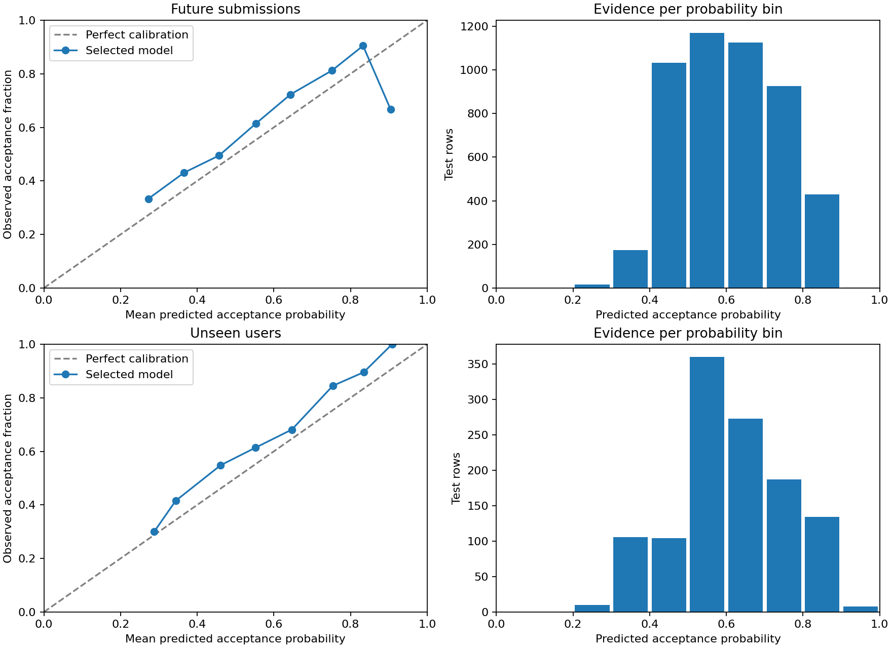

# Final test results

Model selected before testing: **Random Forest depth=16**.

The frozen plan in `test_plan.json` records model settings, artifact/data/code hashes, the original
one-day outcome lag, training-only preprocessing and fits, and threshold 0.5. One setting per model
family was chosen using validation log loss. Neither final test changed these choices. The baseline
is the equal-user-weighted training acceptance rate.

## Results

Lower log loss and Brier are better. Acceptance is the positive class. User averages give every test
user equal influence; submission metrics weight each row equally. Single-class users are excluded
only from user-averaged ROC-AUC; undefined precision/recall/F1 are zero.

## Future submissions

4,876 rows from 65 users: 3,266 accepted and 1,610 rejected. User-averaged ROC-AUC includes 58
users.

### User-averaged metrics

| Model                     | Log loss |  Brier | ROC-AUC | Precision | Recall |     F1 | Accuracy |
| ------------------------- | -------: | -----: | ------: | --------: | -----: | -----: | -------: |
| Acceptance-rate baseline  |   0.6544 | 0.2307 |  0.5000 |    0.6911 | 0.9846 | 0.7980 |   0.6911 |
| Logistic Regression C=0.1 |   0.6268 | 0.2177 |  0.6055 |    0.7172 | 0.7914 | 0.7291 |   0.6586 |
| Random Forest depth=16    |   0.5912 | 0.2025 |  0.6278 |    0.7031 | 0.7790 | 0.7209 |   0.6910 |
| Gradient Boosting depth=2 |   0.5899 | 0.2025 |  0.6201 |    0.6996 | 0.7356 | 0.6911 |   0.6699 |

### Submission-level metrics

| Model                     | Log loss |  Brier | ROC-AUC | Precision | Recall |     F1 | Accuracy |
| ------------------------- | -------: | -----: | ------: | --------: | -----: | -----: | -------: |
| Acceptance-rate baseline  |   0.6596 | 0.2333 |  0.5000 |    0.6698 | 1.0000 | 0.8023 |   0.6698 |
| Logistic Regression C=0.1 |   0.6123 | 0.2119 |  0.6397 |    0.6967 | 0.8849 | 0.7796 |   0.6649 |
| Random Forest depth=16    |   0.5986 | 0.2059 |  0.6807 |    0.7321 | 0.8190 | 0.7731 |   0.6780 |
| Gradient Boosting depth=2 |   0.6090 | 0.2111 |  0.6653 |    0.7414 | 0.7269 | 0.7341 |   0.6473 |

Selected-model user log loss 95% bootstrap interval: [0.5664, 0.6162]. Paired model-minus-baseline
difference: -0.0633, interval [-0.0854, -0.0410]. Negative favors the model.

### Selected-model subgroup checks

| Group                  | Value                    | Rows | Users | User log loss | Baseline | Sparse |
| ---------------------- | ------------------------ | ---: | ----: | ------------: | -------: | ------ |
| Collection-time rating | 1200–1399                | 1130 |    11 |        0.5679 |   0.6455 | No     |
| Collection-time rating | 1400–1599                | 1245 |     9 |        0.5723 |   0.6411 | Yes    |
| Collection-time rating | 1600–1899                |  627 |     9 |        0.5804 |   0.6442 | Yes    |
| Collection-time rating | 1900+                    |  729 |     9 |        0.5435 |   0.6641 | Yes    |
| Collection-time rating | Below 1200               |  928 |    11 |        0.6829 |   0.6785 | No     |
| Collection-time rating | Unrated                  |  217 |    16 |        0.5876 |   0.6519 | No     |
| Difficulty             | 1200–1599                | 1625 |    50 |        0.6547 |   0.6666 | No     |
| Difficulty             | 1600+                    |  839 |    45 |        0.6501 |   0.7016 | No     |
| Difficulty             | Below 1200               | 2350 |    61 |        0.5281 |   0.6351 | No     |
| Difficulty             | Not rated                |   62 |    15 |        0.6327 |   0.6595 | Yes    |
| Historical rating      | No prior rating          |  290 |    22 |        0.6297 |   0.6541 | No     |
| Historical rating      | Prior rating available   | 4586 |    49 |        0.5927 |   0.6550 | No     |
| Outcome history        | Judged history available | 4773 |    59 |        0.5957 |   0.6597 | No     |
| Outcome history        | No judged history        |  103 |    20 |        0.6293 |   0.6456 | No     |
| Prior attempts         | 0–19                     |  273 |    23 |        0.6154 |   0.6506 | No     |
| Prior attempts         | 100–499                  | 2751 |    27 |        0.6220 |   0.6591 | No     |
| Prior attempts         | 20–99                    |  614 |    22 |        0.5774 |   0.6590 | No     |
| Prior attempts         | 500+                     | 1238 |    15 |        0.5583 |   0.6536 | No     |

Topic-level results and the selected-model confusion counts are in `test_results.json`. Topics
overlap. Sparse denotes fewer than 10 users or 100 rows; passing those counts does not establish
statistical reliability.

## Unseen users

1,182 rows from 17 users: 797 accepted and 385 rejected. User-averaged ROC-AUC includes 13 users.

### User-averaged metrics

| Model                     | Log loss |  Brier | ROC-AUC | Precision | Recall |     F1 | Accuracy |
| ------------------------- | -------: | -----: | ------: | --------: | -----: | -----: | -------: |
| Acceptance-rate baseline  |   0.6592 | 0.2331 |  0.5000 |    0.6711 | 0.9412 | 0.7740 |   0.6711 |
| Logistic Regression C=0.1 |   0.6132 | 0.2124 |  0.6265 |    0.7150 | 0.8242 | 0.7540 |   0.6780 |
| Random Forest depth=16    |   0.6036 | 0.2080 |  0.7095 |    0.6877 | 0.7721 | 0.7172 |   0.6839 |
| Gradient Boosting depth=2 |   0.5983 | 0.2059 |  0.6402 |    0.6920 | 0.7378 | 0.7034 |   0.6746 |

### Submission-level metrics

| Model                     | Log loss |  Brier | ROC-AUC | Precision | Recall |     F1 | Accuracy |
| ------------------------- | -------: | -----: | ------: | --------: | -----: | -----: | -------: |
| Acceptance-rate baseline  |   0.6585 | 0.2327 |  0.5000 |    0.6743 | 1.0000 | 0.8055 |   0.6743 |
| Logistic Regression C=0.1 |   0.6046 | 0.2083 |  0.6702 |    0.7211 | 0.8369 | 0.7747 |   0.6717 |
| Random Forest depth=16    |   0.5903 | 0.2024 |  0.6872 |    0.7204 | 0.8695 | 0.7879 |   0.6844 |
| Gradient Boosting depth=2 |   0.5948 | 0.2047 |  0.6877 |    0.7380 | 0.7880 | 0.7621 |   0.6684 |

Selected-model user log loss 95% bootstrap interval: [0.4993, 0.7492]. Paired model-minus-baseline
difference: -0.0556, interval [-0.1368, 0.0642]. Negative favors the model.

### Selected-model subgroup checks

| Group                  | Value                    | Rows | Users | User log loss | Baseline | Sparse |
| ---------------------- | ------------------------ | ---: | ----: | ------------: | -------: | ------ |
| Collection-time rating | 1200–1399                |  393 |     4 |        0.5153 |   0.6438 | Yes    |
| Collection-time rating | 1400–1599                |  201 |     2 |        0.5607 |   0.6450 | Yes    |
| Collection-time rating | 1600–1899                |  397 |     3 |        0.5943 |   0.6592 | Yes    |
| Collection-time rating | 1900+                    |   74 |     2 |        0.5556 |   0.6953 | Yes    |
| Collection-time rating | Below 1200               |   35 |     3 |        0.5180 |   0.6348 | Yes    |
| Collection-time rating | Unrated                  |   82 |     3 |        0.8770 |   0.6897 | Yes    |
| Difficulty             | 1200–1599                |  388 |    12 |        0.6490 |   0.6656 | No     |
| Difficulty             | 1600+                    |  315 |    11 |        0.6741 |   0.7045 | No     |
| Difficulty             | Below 1200               |  424 |    17 |        0.5046 |   0.6269 | No     |
| Difficulty             | Not rated                |   55 |     5 |        0.6901 |   0.7141 | Yes    |
| Historical rating      | No prior rating          |   82 |     3 |        0.8770 |   0.6897 | Yes    |
| Historical rating      | Prior rating available   | 1100 |    14 |        0.5451 |   0.6527 | No     |
| Outcome history        | Judged history available | 1179 |    15 |        0.5519 |   0.6538 | No     |
| Outcome history        | No judged history        |    3 |     2 |        0.9913 |   0.7003 | Yes    |
| Prior attempts         | 0–19                     |   24 |     5 |        0.7473 |   0.6703 | Yes    |
| Prior attempts         | 100–499                  |  561 |     6 |        0.5759 |   0.6514 | Yes    |
| Prior attempts         | 20–99                    |  186 |     5 |        0.5325 |   0.6449 | Yes    |
| Prior attempts         | 500+                     |  411 |     5 |        0.4844 |   0.6440 | Yes    |

Topic-level results and the selected-model confusion counts are in `test_results.json`. Topics
overlap. Sparse denotes fewer than 10 users or 100 rows; passing those counts does not establish
statistical reliability.

## Calibration and uncertainty



Calibration uses fixed probability bins of width 0.1 with submission-weighted means. Empty bins are
omitted; extreme bins can have very little evidence. No calibration mapping was fitted on test
labels.

Intervals use 2,000 paired bootstrap resamples of users, seed 42, retaining each user’s full set of
rows and equal-user influence. They condition on this fitted model and sampled cohort, do not
account for recruitment bias or shared-problem dependence, and are particularly uncertain for the
17-user unseen test. Subgroup comparisons are descriptive, without multiple-comparison correction.

## Interpretation and limitations

- **Future submissions:** the preselected model improves on the baseline on user-averaged log loss
  (0.5912 versus 0.6544).
- **Unseen users:** the preselected model improves on the baseline on user-averaged log loss (0.6036
  versus 0.6592).

These tests measure future first-attempt outcomes for this cohort and held-out users from the same
recruitment process. They do not prove performance for all Codeforces users or arbitrary unattempted
problems. Personal history can update causally under the lag while model parameters stay fixed;
unseen user means unseen during fitting, not necessarily no history.

Snapshot problem ratings/tags, unavailable historical verdict timing, missing difficulty, cold-start
evidence, and self-selection of attempted problems remain limitations. Predictions do not prove DSA
mastery or that recommendations improve learning. Do not choose a new winner or adjust thresholds
using these final scores; further tuning requires a new untouched evaluation set.

## Reproduce

```bash
python3 code/test_models.py --freeze
python3 code/test_models.py
```

Run training and validation checks first as documented in the README. A plan is created exclusively
before scoring. Existing final results are preserved on reruns. For an independent clean
reproduction, use `--output /tmp/dsa-final-reproduction` on both commands; the new plan records the
regenerated artifact hashes. The script contains no fitting or hyperparameter search.

## Reading these results

The temporal-test paired interval is entirely below zero, supporting improvement over the baseline
within this sampled cohort. The unseen-user interval spans zero (−0.1368 to 0.0642): its better
average does not establish a reliable improvement for new users. Only 17 users contribute to that
test, so the uncertainty is substantial.

Gradient Boosting has slightly lower user-averaged log loss than the preselected Random Forest on
both tests (0.5899 versus 0.5912 for future submissions; 0.5983 versus 0.6036 for unseen users).
Random Forest remains the selected model because that decision was made on validation. These small
test differences are descriptive and have not been shown statistically significant.

Unseen users without prior ratings perform worse than baseline (0.8770 versus 0.6897; 82 rows from 3
users). The unseen no-judged-history group is even smaller: only 3 rows from 2 users. These findings
reinforce the need to show insufficient evidence instead of confident weakness claims for sparse
histories. They are not a basis for tuning a cutoff using the test set.
